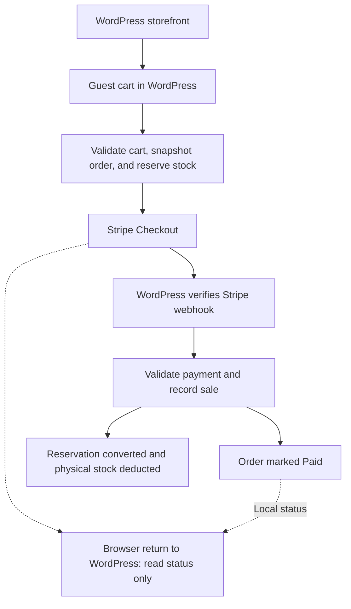

# Architecture

## Overview

CPT2Collection 1.0.0 adds commerce features to an existing WordPress Custom Post Type without replacing its content or structure. The post type remains managed by the theme or plugin that registered it.

WordPress owns product data, carts, orders, and inventory. Stripe hosts the
one-time card checkout. The plugin records a sale after processing verified
payment evidence from Stripe. The [configuration guide](configuration.md)
shows how these pieces are connected on a site.

## Main components

| Component | Responsibility |
| --- | --- |
| WordPress bootstrap | The plugin entry point loads dependencies and plugin classes. On `plugins_loaded`, it checks the schema and registers admin screens, shortcodes, REST hooks, and scheduled notification handlers. |
| Catalog and admin | The settings screen selects the managed post type. Post metadata stores price in minor currency units, commercial status, physical stock, rating, and the minimum-order exemption. |
| Storefront | Shortcodes render product and cart controls. JavaScript calls the WordPress REST API to load and change the cart, initiate checkout, and read the result after returning from Stripe. |
| Commerce services and storage | Services apply checkout and stock rules. Repositories store carts, order and line snapshots, reservations, payment sessions, and provider event and identity records in dedicated InnoDB tables. |
| Stripe integration | The Checkout adapter submits session requests through the Stripe SDK. The webhook endpoint verifies inbound events before handing them to the payment services. |

Activation provisions the schema. The plugin also checks for upgrades during
normal startup. Migrations track a schema version separately from the plugin
version. See [Installation and upgrades](installation.md) before upgrading a
populated installation.

## Cart and checkout flow

1. The guest adds products using a storefront control. WordPress stores cart
   contents on the server. An opaque cookie identifies the cart, and the
   database stores the token's hash. Cart mutations and checkout requests
   require a same-origin check and a signed, time-limited request token.
2. Checkout rechecks the cart and product eligibility, including prices,
   quantities, and the minimum-order rule. It creates a **Pending** order with
   snapshots of the items, quantities, prices, currency, and totals, then
   acquires stock reservations. Adding an item to the cart does not hold stock.
3. The payment service checks the reservations and records a local payment
   attempt before calling Stripe. It sends the order snapshot as line items
   and requests a Checkout Session that expires at the reservation deadline.
   At least 30 minutes must remain when the request is made.
4. After the session is accepted and saved locally, the order becomes
   **Awaiting payment**. The checkout response supplies the Stripe URL and
   the browser redirects there.

## Payment processing

WordPress verifies the Stripe signature over the raw webhook body using the
configured signing secret. The payment service then checks that the event
belongs to the expected environment and Checkout Session and that the paid
amount and currency match the local order. A checkout completion event with
payment still pending does not confirm a sale.

A successful sale updates the order to **Paid**, converts the reservations,
and deducts physical stock in one database transaction. The transaction
records the payment result and queues eligible notifications. Cart updates
after the sale are handled separately. WordPress cron submits the customer
and administrator emails. See [Orders and notifications](orders.md).

Checkout uses a Stripe idempotency key for the recorded payment attempt.
On the inbound side, durable event, session, and payment identities let the
plugin recognize repeat delivery and check the existing outcome. Replaying a
confirmed event does not deduct stock again. Conflicting evidence can require
review.

The success page reads the local result for the Checkout Session ID and the
original cart cookie. A browser redirect cannot mark an order **Paid**. The
result can still be pending if the verified webhook has yet to be processed.

## Stock and concurrency

Physical stock is the quantity recorded on the product. Available stock is
that quantity minus active, unexpired reservations. A reservation reduces
availability during checkout. Its deadline ends the hold for availability
calculations. Processing Stripe's expiration event can separately move an
unpaid order to **Expired**.

Reservations, paid stock deductions, and the plugin's admin stock editor use
the same per-product database lock. This lets checkout check availability and
reserve stock while other operations on the same product wait. Admin stock
edits reject stale values and quantities below current reservations. Direct
metadata writes from other code do not use these safeguards. See
[Catalog, cart and stock](catalog-and-stock.md).

## Recovery and reset

If a database connection is lost during a transaction, the plugin may not 
immediately know whether the changes were committed. Likewise, an interrupted 
Stripe request may have created a Checkout Session. The plugin uses durable 
local records and provider evidence to check the outcome before continuing 
affected operations. Some outcomes require review when the available evidence 
cannot establish a safe next step.

A commerce epoch identifies a generation of local commerce records. Full
Commerce Reset is a destructive administrator operation. It blocks normal
commerce while it validates the old epoch, preserves payment evidence, and
removes operational records. Commerce resumes in a new epoch after reset
completes. Physical stock is preserved, and retained evidence lets the
plugin recognize old Stripe events without applying them to new orders.
Stripe payments remain in Stripe. See [Commerce maintenance](commerce-reset.md)
for backup requirements and payment handling.

## Build and dependencies

The release build stages the runtime files and installs dependencies from the
Composer lock file. PHP-Scoper places the Stripe SDK under
`CPT2CollectionVendor\Stripe` and rewrites the plugin's SDK references to
match. This lets the bundled SDK coexist with other versions. WordPress
continues to supply its own classes and functions at runtime.

Composer regenerates its autoload files for the scoped namespace. The build
adds a release loader, verifies the packaged files, and produces
`dist/cpt2collection.zip` with one `cpt2collection/` directory. The plugin
entry point loads the generated release loader when present. Source checkouts
use the ordinary Composer autoloader when installed.

Install the attached release ZIP in WordPress. GitHub's generated source
archives need a build to produce the installable package. See
[Build and test](development.md) for the tool requirements and commands.
