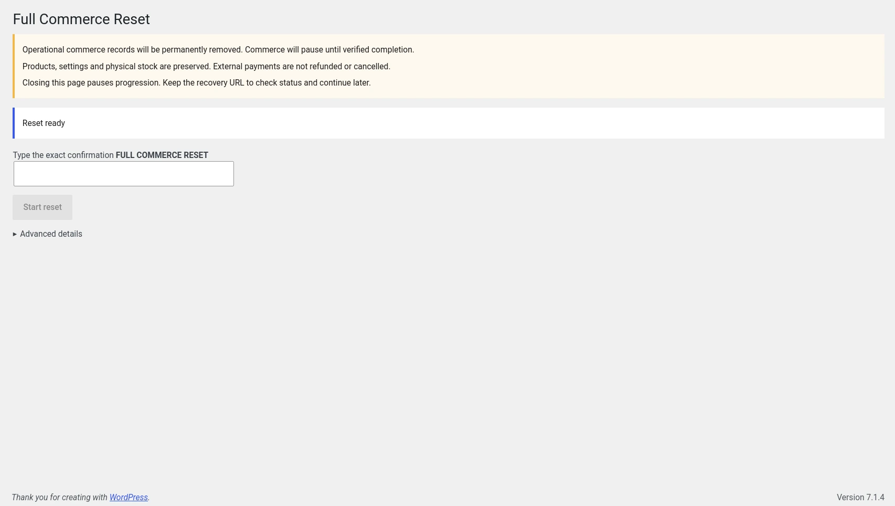

# Commerce maintenance

## Overview

**Full Commerce Reset permanently removes local commerce records from this
WordPress site.** Use it only for exceptional maintenance, such as starting
with an empty order history after testing on a dedicated staging site.
Routine stock corrections, individual order problems, and refunds do not
require a full reset.

Plan for downtime. Once the reset starts, CPT2Collection blocks normal
commerce activity, including cart changes and new checkouts, until verified
completion. The reset works through a series of steps. How long it takes
depends on the amount of commerce data and payment history.

## What gets deleted

A completed reset clears the plugin's local commerce records, including
older records still stored on the site.

| Local records | What the reset removes |
| --- | --- |
| Guest carts | Existing carts and the items in them. Visitors will need to build new carts. |
| Orders | Order records, purchased items, saved customer details, and order notification records. Pending order emails lose their local records too. |
| Stock reservations | The holds placed on products during checkout. |
| Payment operations | Local Checkout Session records and operational webhook event records. |

Old order details are no longer available through **Orders** or the payment
success page. Clearing reservations leaves the recorded physical quantities
as they were. A sale that already deducted stock is not reversed by reset.

## What is preserved

Your catalog posts, CPT2Collection product fields, settings, and physical
stock remain in WordPress. A reset leaves prices, commercial statuses, and
the configured Stripe credentials in place.

The plugin retains payment evidence used to recognize old Stripe activity.
That evidence serves a different purpose from an order history. It cannot
restore a deleted order or provide the order details you need for
fulfilment or recordkeeping.

The plugin groups commerce records into generations called *epochs*. Once
the reset is complete, new carts and orders belong to a new epoch. Retained
evidence helps the plugin recognize old payment notifications without
applying them to the new orders.

Stripe's records remain in Stripe. The reset can delete a local record of
a Checkout Session while the session itself still exists at Stripe.

## Before you reset

1. **Schedule a maintenance window.** Stop customers from starting new
   checkouts while you review existing activity. Allow time for the reset
   and your checks before reopening. Keep administrator access available.
2. **Review Orders.** Check for unfulfilled orders, payments that need
   review, and outstanding refunds. Save the order and customer information
   you still need in an appropriate, protected location. See
   [Orders and notifications](orders.md).
3. **Review Stripe separately.** Compare Stripe's payments with the local
   orders. Resolve discrepancies before proceeding. Check for open
   Checkout Sessions and arrange for them to finish or expire, or handle
   their cancellation separately in Stripe as appropriate. Handle any
   refunds separately as well. Important: Pausing commerce in WordPress 
   does not automatically cancel Checkout Sessions already open in Stripe. 
   Customers may still complete those payments, so review and resolve 
   outstanding sessions before proceeding.
4. **Record your current stock.** Note the physical quantities you want to
   verify afterwards. Review any test sales that already changed inventory.
5. **Make and verify a current WordPress database backup.** Keep it before
   starting the reset. If restoration becomes necessary, review payments
   and other activity since the backup with your site maintainer first.
   Restoring WordPress does not restore Stripe to the same point in time.

If you cannot tell whether a payment went through or a local change was
saved, resolve the uncertainty before starting. Reset removes records that
you may need to investigate.

## Running Full Commerce Reset

1. Sign in to WordPress with an account that can manage site settings
   (`manage_options`). Use a browser with JavaScript enabled and open
   **CPT2Collection → Full Commerce Reset**.
2. Read the warning. When the page shows **Reset ready**, type
   `FULL COMMERCE RESET` exactly and click **Start reset**.
3. Copy the **Recovery URL** as soon as it appears and store it securely for 
   this maintenance window. Do not share it publicly. It identifies the 
   specific reset you started.
4. Keep the page open while the reset progresses. The screen shows the
   current phase, such as **Checking commerce records**, **Preserving payment
   history**, **Removing commerce records**, or **Finishing reset**.
5. If you need to stop sending new steps, click **Pause after current step**.
   The current step may finish. When you are ready, use **Continue reset**
   if offered. Pausing leaves commerce unavailable and keeps any deletions
   that have already been committed.

If the screen says a ready commerce context could not be verified, use
**Advanced details** to look up the existing operation if you have its
identity. If you cannot verify the current state, ask your site maintainer
to investigate before starting a reset.

## If the reset is interrupted

Closing the page or losing your connection stops the browser from
requesting more steps. A request that already reached WordPress may still
have completed. An interruption does not cancel the reset or restore data.

- **Reopen the Recovery URL.** If your login expired, sign in and open the
  same URL again. It checks the saved operation status. Alternatively,
  enter the exact operation identity under **Advanced details** and click
  **Check status**. Checking status does not advance the reset.
- **If you see Reset paused**, review the status and use **Continue reset**
  when offered. The page checks the recorded progress before continuing.
- **If the initial start was interrupted**, check that same operation
  first. If WordPress offers **Retry same start**, it has checked that
  the saved operation was not found. Type the same confirmation phrase
  again to retry the start for that operation.
- **If you see Reset blocked**, keep the shop closed and give your site
  maintainer the **Recovery URL** and the information under **Advanced
  details**. Automatic continuation is unavailable in this state. If
  the status cannot be verified, or a payment outcome is uncertain,
  have the maintainer check WordPress and the relevant Stripe records
  before taking further action.

Use the controls for the existing operation. Starting another reset or
editing database records directly can complicate recovery.

## After the reset

Before reopening the shop, work through these checks.

- Confirm completion for the operation you ran. The current reset normally
  shows **Reset complete. Commerce is available again.** A historical
  completion may instead say **Reset complete. Check current commerce
  status separately.** In that case, check that commerce is available now.
- Use **Back to Orders** and clear any filters. The old local orders should
  be gone.
- Open a few products and verify their prices, commercial statuses, and
  physical stock against the values you recorded before reset.
- Check that a visitor can start a fresh cart and update quantities.
  Follow the [configuration guide](configuration.md#test-your-configuration)
  if you need to verify the full checkout flow. Test purchases create
  local orders and can change stock.
- Check any previously open payments separately in Stripe before resuming
  fulfilment. The cleared **Orders** screen only describes the local
  WordPress records.

## Important limitations

The reset screen has no undo. A pause or interruption can leave some
records already deleted while commerce remains unavailable.

Handle fulfilment, cancellations, and refunds separately. A payment can
still exist in Stripe after its WordPress order is removed. Keep backups
and business records under your own retention policy. Full Commerce Reset
leaves retained payment evidence, external provider records, and existing
backups in place.
