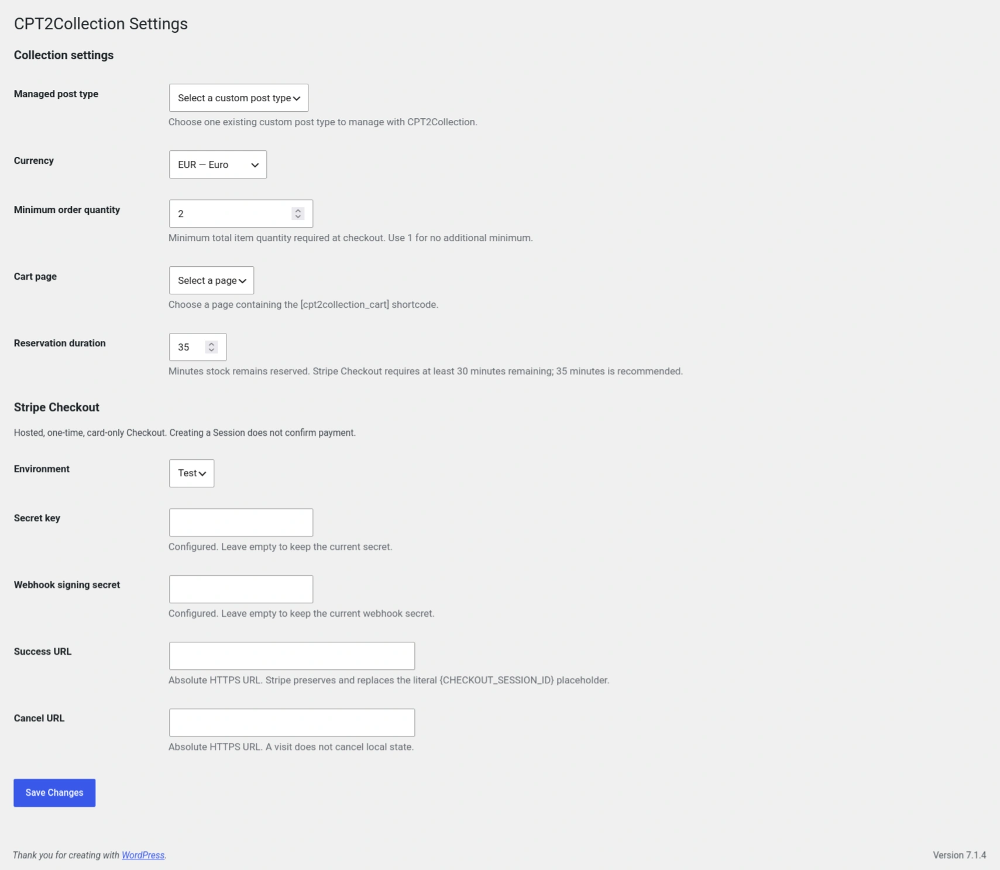
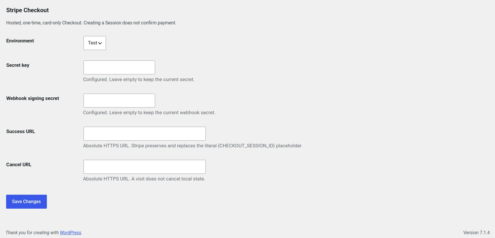
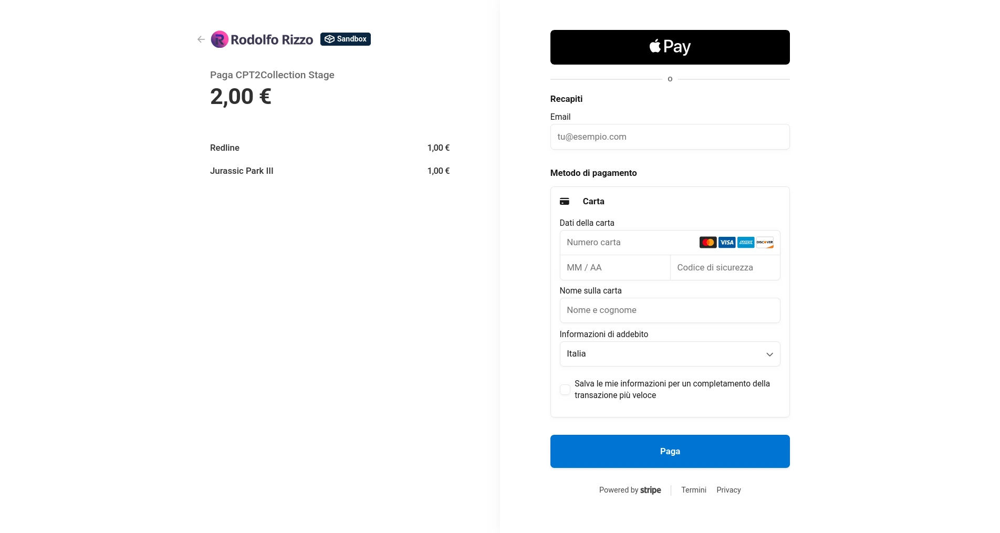
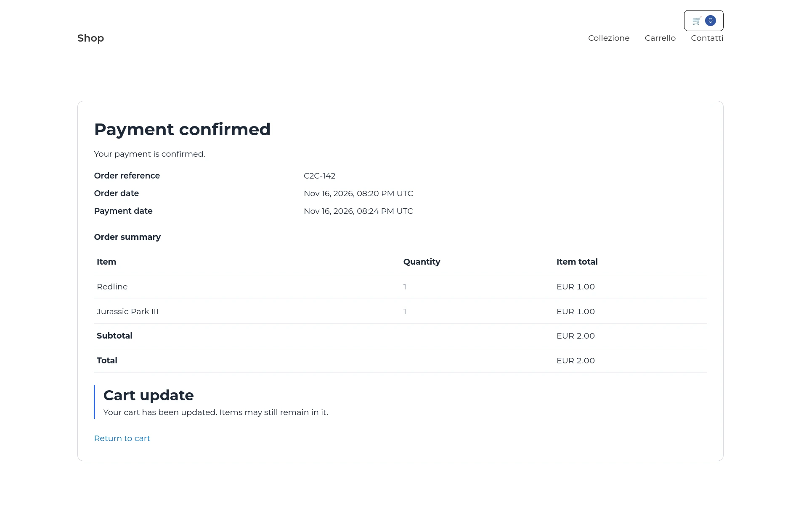

# Configuration

This guide will help you set up CPT2Collection, prepare your products, and get your WordPress site ready to accept payments.

## Getting started

Before configuring the plugin, make sure you have:

- **WordPress 6.4 or later, PHP 8.2 or later, and CPT2Collection installed and active.** Follow the [installation guide](installation.md) if you still need to install the plugin. Ask your hosting provider to confirm the [checkout requirements](../README.md#requirements-and-installation) if you're unsure.
- **An existing Custom Post Type (CPT).** Your theme or another plugin must already provide the post type you want to use as a product catalog.
- **At least one published item** in that Custom Post Type.
- **A Stripe account** to test payments before accepting real orders.
- **HTTPS enabled** on your website.

To begin:

1. Log in to your WordPress dashboard as an administrator.
2. Open **CPT2Collection → Settings**.
3. Configure your catalog using the options described below.
4. Click **Save Changes** when you're finished.

**Tip:** If possible, set up and test the plugin on a separate staging website first. Stripe test payments don't charge real cards, but they still create orders, update stock, and may send emails from your WordPress site.

## Catalog settings

Open **CPT2Collection → Settings** and find the **Collection settings** section.

### Choose your Custom Post Type

Under **Managed post type**, select the Custom Post Type you want to use as your product catalog.

For example, if your website already has a Custom Post Type called `artworks`, you can select it to start selling those items.

CPT2Collection uses your existing posts. You don't need to recreate your catalog.

If your Custom Post Type doesn't appear in the list, make sure it is registered as public, has a WordPress admin interface, and that the theme or plugin providing it is active.

Built-in WordPress Posts and Pages cannot be selected.

### Currency

Choose the currency for your products:

- **EUR** — Euro (default)
- **USD** — US Dollar

Choose your currency before entering product prices.

**Important:** Changing the currency does not automatically convert existing prices. For example, a price of `20` remains `20`, but it will be displayed in the newly selected currency.

### Minimum order quantity

This setting defines the minimum number of units a customer must add to the cart before proceeding to checkout.

For example, if you set the minimum to `3`, customers can purchase:

- Three units of the same product.
- Two units of one product and one unit of another.
- Any other combination totaling at least three units.

The minimum applies to the total number of units, not the number of different products or the order value.

Leave the setting at `1` if you don't need a minimum quantity.

**Exceptions:** Individual products can be marked **Can be purchased without reaching the minimum order quantity**. If the cart contains an eligible product with this option enabled, the minimum quantity requirement is waived for the entire cart. Other checkout rules still apply.

### Reservation duration

When a customer starts checkout, CPT2Collection temporarily reserves the selected items so they cannot be purchased by another customer at the same time.

The **Reservation duration** setting controls how long these items remain reserved.

- Default: **35 minutes**
- Allowed range: **5–120 minutes**

We recommend keeping the default value when first configuring the plugin.

**Note:** Stripe Checkout needs at least 30 minutes left on the reservation when the plugin requests a Checkout Session. A setting below 30 minutes cannot work, and exactly 30 minutes leaves no time for processing. Use 35 minutes or more.

### Set up your products

Once your catalog settings are saved:

1. Open an existing published item in your selected Custom Post Type.
2. Find the **CPT2Collection** panel in the WordPress editor.
3. Enter a positive **Price**, such as `12.90`, without a currency symbol.
4. Enter your physical **Stock** as a whole number, including any units held for checkout. Use `0` for an out-of-stock item.
5. Set **Commercial status** to **Available**.
6. Update the post.

**Not for sale** is the default commercial status. **Reserved** and **Sold** also prevent purchases. The **Reserved** status is separate from the temporary stock hold during checkout.

You can also set an optional **Rating** to display on the product page or allow the product to bypass the minimum order quantity requirement.

Repeat these steps for the products you want to sell.

### Understanding stock and reservations

CPT2Collection distinguishes between **physical stock** and **available stock**.

Physical stock is the quantity you actually have. Available stock is what customers can still reserve after accounting for active checkout reservations.

For example, imagine you have **10 units** of a product:

| Event | Physical stock | Available stock |
| --- | ---: | ---: |
| Before any checkout | 10 | 10 |
| A customer reserves 3 units | 10 | 7 |
| WordPress confirms payment and records the sale | 7 | 7 |

If the customer doesn't complete payment and the reservation expires, those 3 units become available again without reducing physical stock.

Simply adding a product to the cart does not reserve it. The reservation starts during checkout.

**Important:** When stock reaches zero, CPT2Collection does not automatically change the product's **Commercial status** to **Sold**.

For more details about stock editing, reservations, and conflicting changes, see [Catalog, cart and stock](catalog-and-stock.md).

## Cart and checkout pages

Before customers can purchase your products, you need to create a cart page and two pages for returning from Stripe Checkout.

### Create the required pages

In your WordPress dashboard, go to **Pages → Add New** and create these three pages:

| Page | Shortcode | Purpose |
| --- | --- | --- |
| Shopping Cart | `[cpt2collection_cart]` | Displays the cart and lets customers review their items before checkout. |
| Payment Success | `[cpt2collection_checkout_success]` | Shows the payment status when customers return from Stripe Checkout. |
| Payment Cancelled | `[cpt2collection_checkout_cancel]` | Provides a way back to the cart when customers leave Stripe Checkout without completing payment. |

You can choose any page titles you prefer.

For each page:

1. Add a **Shortcode** block in the WordPress editor.
2. Paste the corresponding shortcode from the table.
3. Publish the page.

The success and cancellation pages will be connected to Stripe later in this guide.

### Connect your cart page

Once your pages are published:

1. Open **CPT2Collection → Settings**.
2. Find **Collection settings**.
3. Under **Cart page**, select the Shopping Cart page you created.
4. Click **Save Changes**.

This allows CPT2Collection to link customers to the correct cart page.

### Add purchase buttons to your products

To let customers add products to their cart, use the following shortcode:

`[cpt2collection_add_to_cart]`

For example, to add a purchase button to an existing catalog item:

1. Open the item in the WordPress editor.
2. Add a **Shortcode** block where you want the purchase controls to appear.
3. Enter `[cpt2collection_add_to_cart]`.
4. Update the post.

The shortcode displays a quantity field and an **Add to cart** button.

**Using the shortcode elsewhere**

You can also display the purchase controls outside the product's own page by specifying its WordPress post ID.

For example:

`[cpt2collection_add_to_cart post_id="123"]`

Replace `123` with the actual ID of your catalog item.

This is useful when building custom catalog layouts or product listings.

Make sure customers can easily reach the cart, for example through a navigation link or the optional mini cart.

### Available shortcodes

CPT2Collection provides eight shortcodes for displaying product information, cart controls, and checkout return messages.

| Shortcode | Description |
| --- | --- |
| `[cpt2collection_add_to_cart]` | Displays the quantity field and Add to cart button for a product. |
| `[cpt2collection_cart]` | Displays the full shopping cart, including items, quantities, totals, and checkout controls. |
| `[cpt2collection_mini_cart]` | Displays a compact cart summary with a link to the cart page. |
| `[cpt2collection_cart_count]` | Displays the total number of units currently in the cart. |
| `[cpt2collection_price]` | Displays a product's formatted price. |
| `[cpt2collection_rating]` | Displays a product's saved rating. |
| `[cpt2collection_checkout_success]` | Displays payment status and, when confirmed, an Order summary after returning from Stripe. |
| `[cpt2collection_checkout_cancel]` | Displays a cancellation message and a link back to the cart. |

**Optional shortcode attributes**

Some shortcodes accept additional attributes:

- **Product ID:** Use `post_id="123"` with `add_to_cart`, `price`, or `rating` to display information for a specific product. Without this attribute, the shortcode uses the current post.
- **Hide an empty cart count:** Use `[cpt2collection_cart_count hide_when_empty="yes"]` to hide the count when the cart is empty. By default, the count remains visible.

### How customers use the cart

Once everything is configured, the shopping experience is straightforward:

1. A visitor opens your catalog and chooses a product.
2. They select a quantity and click **Add to cart**.
3. They open the cart to review their items and adjust quantities.
4. When ready, they click **Proceed to checkout**.
5. CPT2Collection checks the cart and available stock, then redirects them to Stripe's secure payment page.

Customers do not need a WordPress account to place an order.

**Important:** Adding an item to the cart does not reserve stock. Products are temporarily reserved when checkout starts.

You do not need to create a separate WordPress payment form. Stripe hosts the payment page.

### Check your cart setup

Before configuring Stripe, make sure the cart works:

1. Open your catalog in a private or logged-out browser window.
2. Add a product to the cart.
3. Open your Shopping Cart page.
4. Check that the product, quantity, and price are displayed correctly.
5. Try changing the quantity or removing the product.

Your browser must have JavaScript and cookies enabled for the cart to work correctly.

The **Proceed to checkout** button will be ready to start a payment once you complete the Stripe configuration in the next section.

## Stripe configuration

CPT2Collection uses **Stripe Checkout** to accept one-time card payments on a secure page hosted by Stripe.

When a customer is ready to pay, they are redirected to Stripe Checkout. After payment, Stripe notifies your WordPress website so CPT2Collection can confirm the order and update stock.

Before accepting real payments, you should configure and test the integration using Stripe's test environment.

### Step 1: Enable Stripe test mode

1. Log in to your WordPress dashboard.
2. Open **CPT2Collection → Settings**.
3. Find the **Stripe Checkout** section.
4. Make sure **Environment** is set to **Test**.

Test mode allows you to simulate payments without charging real credit cards.

**Important:** Test payments still create orders, reserve products, update stock, and may send emails on your WordPress website.

### Step 2: Get your Stripe test API key

CPT2Collection needs a Stripe API key to create Checkout Sessions.

A *Checkout Session* contains the products and payment details that Stripe displays to the customer.

To get your test API key:

1. Sign in to your [Stripe Dashboard](https://dashboard.stripe.com/).
2. Switch to the Stripe test environment.
3. Open **Developers → API keys**.
4. Find your **Secret key**, which starts with `sk_test_`.
5. Copy the key.

Return to **CPT2Collection → Settings** and paste the key into the **Secret key** field under **Stripe Checkout**.

**Keep this key private.** Never publish it, include it in screenshots, or commit it to a Git repository.

### Step 3: Create a Stripe webhook

A *webhook* allows Stripe to send payment notifications directly to your WordPress website.

This is essential because a customer might close their browser after paying or never return to your website.

CPT2Collection uses these notifications to confirm successful payments and update orders.

In your Stripe test environment:

1. Open the webhook management area in the Stripe Dashboard.
2. Create a new webhook endpoint (also called an event destination). If Stripe asks you to choose an event format, select **Snapshot** to send the full Checkout Session details.
3. Enter your website's webhook URL.

For most WordPress websites, the URL is:

`https://example.com/wp-json/cpt2collection/v1/stripe/webhook`

Replace `example.com` with your actual domain.

For example, if your website is `https://myshop.com`, use:

`https://myshop.com/wp-json/cpt2collection/v1/stripe/webhook`

Your website must use HTTPS, and Stripe must be able to send requests to this address without a WordPress login.

### Step 4: Select the webhook events

When configuring the webhook, select these three events:

| Stripe event | Purpose |
| --- | --- |
| `checkout.session.completed` | Notifies CPT2Collection when a customer completes Stripe Checkout. |
| `checkout.session.async_payment_succeeded` | Confirms a successful payment that was processed asynchronously. |
| `checkout.session.expired` | Notifies CPT2Collection when a Checkout Session expires. |

You do not need to subscribe to every Stripe event.

Save the webhook endpoint in Stripe.

### Step 5: Get the webhook signing secret

Each Stripe webhook endpoint has its own **signing secret**.

This secret allows CPT2Collection to verify that an incoming payment notification really came from Stripe.

After creating the webhook:

1. Open the endpoint you just created in Stripe.
2. Find its **Signing secret**.
3. Reveal and copy the secret. It starts with `whsec_`.
4. Return to **CPT2Collection → Settings**.
5. Paste it into **Webhook signing secret**.

You should now have two different secrets configured:

| CPT2Collection field | Stripe credential | Purpose |
| --- | --- | --- |
| **Secret key** | `sk_test_...` | Allows the plugin to create Stripe Checkout Sessions. |
| **Webhook signing secret** | `whsec_...` | Allows the plugin to verify Stripe's payment notifications. |

These credentials are not interchangeable.

**Important:** Always use the signing secret belonging to the webhook endpoint you created for this website and environment.

### Step 6: Save your settings

Before saving, check that:

- **Environment** is set to **Test**.
- **Secret key** contains your Stripe test API key.
- **Webhook signing secret** contains the correct test webhook secret.
- Your webhook endpoint is configured to receive the three required events.

You will also need to configure **Success URL** and **Cancel URL**, which are explained in the next section.

After entering those URLs, click **Save Changes**.

### Advanced: Alternative webhook URLs

The standard webhook URL works on most WordPress websites using pretty permalinks.

If your website uses plain permalinks, the endpoint may look like this:

`https://example.com/?rest_route=/cpt2collection/v1/stripe/webhook`

If WordPress is installed in a subdirectory or uses a custom REST API base, the URL may be different.

Always use the actual WordPress REST URL for your installation.

If your staging website is protected by a password, firewall, or access restrictions, make sure Stripe can reach the webhook endpoint.

Do not disable CPT2Collection's webhook signature verification.

### Advanced: Store Stripe credentials outside WordPress

By default, Stripe credentials entered in the plugin settings are stored in the WordPress database.

For environments where credentials are managed through server configuration, CPT2Collection supports these WordPress constants:

- `CPT2COLLECTION_STRIPE_SECRET_KEY`
- `CPT2COLLECTION_STRIPE_WEBHOOK_SECRET`

When defined in your server-side WordPress configuration, these values take precedence over the corresponding fields in the dashboard.

This option is intended for administrators familiar with secure WordPress configuration and secret management.

**Security recommendations:**

- Never store Stripe secrets in a public repository.
- Protect WordPress configuration files and database backups.
- Do not share secret keys in screenshots, support requests, or public logs.
- Use separate credentials for Stripe test and live environments.

**Note:** Saved credentials are not displayed in the settings fields. Leaving a credential field blank when saving preserves its existing value. If a server-side constant is defined, changing the corresponding dashboard field will not override it.

## Payment confirmation pages

After a customer leaves Stripe Checkout, they can return to your WordPress website.

CPT2Collection uses two pages for this purpose:

- **Payment Success:** Shows the payment status and, once confirmed, an order summary.
- **Payment Cancelled:** Provides a way back to the shopping cart if the customer leaves Stripe Checkout without paying.

You created these pages earlier in the [Cart and checkout pages](#cart-and-checkout-pages) section. Now you need to connect them to Stripe.

### Step 1: Configure the success URL

The success URL tells Stripe where to send customers after they complete Checkout.

1. In WordPress, open the page containing `[cpt2collection_checkout_success]`.
2. Copy its public URL.
3. Open **CPT2Collection → Settings**.
4. Under **Stripe Checkout**, find **Success URL**.
5. Enter the page URL and append `?session_id={CHECKOUT_SESSION_ID}`.

For example, if your success page is:

`https://example.com/payment-success/`

Enter this in **Success URL**:

`https://example.com/payment-success/?session_id={CHECKOUT_SESSION_ID}`

**Important:** Keep `{CHECKOUT_SESSION_ID}` exactly as written, including the curly braces.

Stripe replaces this placeholder with the Checkout Session ID. CPT2Collection uses that ID and the original browser's cart cookie to show the order. When testing, return in the same browser session and keep the private window open until you've checked the result.

If the page URL already contains a question mark and query parameters, append `&session_id={CHECKOUT_SESSION_ID}` instead.

### Step 2: Configure the cancellation URL

The cancellation URL tells Stripe where customers can return if they decide not to complete Checkout.

1. Open the WordPress page containing `[cpt2collection_checkout_cancel]`.
2. Copy its public URL.
3. Return to **CPT2Collection → Settings**.
4. Under **Stripe Checkout**, find **Cancel URL**.
5. Paste the page URL without adding a session ID.

For example:

`https://example.com/payment-cancelled/`

The cancellation page displays a message and provides a link back to the shopping cart.

### Step 3: Save your settings

Before saving, check that:

- Both pages are published and accessible to visitors.
- **Success URL** points to the page containing `[cpt2collection_checkout_success]`.
- **Success URL** includes the `{CHECKOUT_SESSION_ID}` placeholder.
- **Cancel URL** points to the page containing `[cpt2collection_checkout_cancel]`.
- Both URLs use HTTPS and belong to the same WordPress website as the cart.

Click **Save Changes**.

Your Stripe Checkout configuration is now ready for testing.

### How payment confirmation works

A new order starts as **Pending**. It normally changes to **Awaiting payment** when the Stripe Checkout Session is ready.

When CPT2Collection verifies the payment and records the sale, it marks the order **Paid** and deducts the purchased quantity from physical stock together. Eligible emails are then queued. If a payment needs review, investigate before fulfilling the order.

For example:

| What happens | Order status | Stock |
| --- | --- | --- |
| Customer starts Checkout | Pending / Awaiting payment | Temporarily reserved |
| WordPress verifies payment and records the sale | Paid | Purchased quantity deducted |
| An unpaid reservation reaches its time limit | May still show Awaiting payment | Reserved units become available again |
| WordPress processes Stripe's session expiration notification | Expired | Physical stock is unchanged |

**Important:** Returning to the Payment Success page does not prove that payment was successful.

For example, a customer might return before Stripe's payment notification reaches your website.

The success page checks the order status and may temporarily display a message indicating that payment confirmation is pending. If available, the customer can use **Check status** to refresh the result.

Before preparing or delivering an order, always verify that it is marked **Paid** under **CPT2Collection → Orders**.

### What happens when a customer cancels?

If a customer uses Stripe's return link without completing payment, they are redirected to your Payment Cancelled page.

This page helps them return to the shopping cart.

However, visiting the cancellation page does not automatically:

- Cancel an existing Stripe payment.
- Cancel or delete the WordPress order.
- Release reserved stock immediately.

An active stock reservation normally remains in place until it expires or is otherwise released through the checkout lifecycle.

This prevents a browser navigation from incorrectly changing the state of an order or payment.

You can learn more about order statuses and payment handling in [Orders and notifications](orders.md).

## Email notifications

When an order becomes **Paid**, CPT2Collection can queue two separate email notifications. Each needs a valid recipient address:

- **Customer notification:** Confirms the payment and provides information about the order.
- **Administrator notification:** Informs the website administrator that a new paid order has been received.

These notifications are sent separately through WordPress.

CPT2Collection uses WordPress's email system, so your website must be able to send outgoing emails correctly.

### Step 1: Check the administrator email address

CPT2Collection sends new paid order notifications to the WordPress administration email address.

To check it:

1. Log in to your WordPress dashboard.
2. Open **Settings → General**.
3. Find **Administration Email Address**.
4. Make sure the address is correct and belongs to someone who manages the website.

The **New paid order** notification uses this address. If it changes before the email is sent, the notification can be skipped.

### Step 2: Understand customer notifications

CPT2Collection uses the email address Stripe provides during Checkout for the **Payment confirmed** notification.

For example, if a customer completes a purchase using `customer@example.com`, CPT2Collection uses that address for the payment confirmation.

**Important:** A customer notification can only be prepared when Stripe provides a valid email address.

You do not need to create a WordPress account for the customer.

### Step 3: Make sure WordPress can send emails

CPT2Collection uses the standard WordPress email system.

Depending on your hosting provider, outgoing emails may work automatically or may require additional configuration.

To improve email delivery, you can use an SMTP plugin or a transactional email service.

For example, your website might send emails through your hosting provider's SMTP server or a dedicated email provider.

**Before accepting real orders**, make sure WordPress can successfully send emails to external addresses.

### Step 4: Check scheduled tasks (WP-Cron)

CPT2Collection uses WordPress scheduled tasks, commonly called **WP-Cron**, to process payment notifications.

After a payment is confirmed, the plugin schedules a notification check. It also checks hourly for emails still waiting to be sent. Failed sends are not retried.

On most WordPress websites, WP-Cron runs automatically when visitors access the site.

However, on low-traffic websites, scheduled tasks may run later than expected.

If your hosting provider disables automatic WP-Cron, make sure a server-side scheduler runs WordPress cron events.

You do not need to configure WP-Cron manually if it is already working correctly.

### Step 5: Verify email delivery

After completing a test payment, check that both notifications arrive:

| Notification | Recipient | When it is prepared |
| --- | --- | --- |
| **Payment confirmed** | Customer email provided by Stripe | After payment confirmation |
| **New paid order** | WordPress administration email address | After payment confirmation |

Check the inboxes and spam folders of both recipients.

**Important:** An order can be marked **Paid** even if an email is delayed or fails.

CPT2Collection makes at most one submission attempt for each notification. WordPress accepting an email for sending does not guarantee that the message will reach the recipient's inbox.

For this reason, always use **CPT2Collection → Orders** as the reference for confirmed payments, rather than relying only on email notifications.

### If emails are not arriving

If an order is marked **Paid** but one or both notifications are missing, check the following:

1. **Recipient addresses:** Verify the administrator email and the customer's address.
2. **Spam folders:** Check whether the messages were filtered.
3. **WordPress email configuration:** Make sure your hosting provider or SMTP service allows outgoing messages.
4. **WP-Cron:** Check that scheduled WordPress tasks are running.
5. **Mail provider logs:** If available, look for delivery errors or rejected messages.

After fixing a mail problem in Test mode, make a new test purchase to check delivery.

For additional information about order statuses and notifications, see [Orders and notifications](orders.md).

## Test your configuration

Before accepting real payments, complete a test purchase to make sure CPT2Collection, Stripe, and your WordPress website are working together correctly.

Stripe's test environment lets you simulate payments without charging real money.

**Important:** Test purchases still create orders, update product stock, and may send real email notifications. We recommend testing on a staging website whenever possible.

### Step 1: Check your settings

Open **CPT2Collection → Settings** and make sure:

- **Environment** is set to **Test**.
- Your Stripe test API key and webhook signing secret are configured.
- Stripe is subscribed to the three required webhook events.
- Your **Cart page**, **Success URL**, and **Cancel URL** are configured.
- Your test product has a price, available stock, and **Commercial status** set to **Available**.

Choose a product with enough stock to meet your minimum order quantity.

Before testing, write down its current stock quantity so you can compare it after payment.

### Step 2: Add a product to the cart

Open your website in a private browser window, without logging in to WordPress.

1. Visit your product catalog.
2. Choose a product and click **Add to cart**.
3. Open the shopping cart.
4. Check that the product name, quantity, price, and total are correct.

If everything looks right, continue to checkout.

### Step 3: Complete a Stripe test payment

1. In the cart, click **Proceed to checkout**.
2. Confirm that Stripe Checkout opens and displays the correct items and total.
3. Use a Stripe test card to complete the payment.
4. Enter an email address you can access.
5. Complete Checkout and return to your website.

For a standard successful card payment, Stripe provides this test card number:

`4242 4242 4242 4242`

Use a future expiration date, any valid three-digit CVC, and the requested billing information.

This card works only in Stripe's test environment. It does not charge real money.

You can find additional test payment methods in the [Stripe testing documentation](https://docs.stripe.com/testing).

### Step 4: Check the payment confirmation

After completing Stripe Checkout, you should return to your Payment Success page.

The page should display the payment result and, once confirmed, an order summary.

If payment confirmation is still pending, give Stripe's webhook time to reach your website. Use **Check status** if the page offers that option.

**Important:** Returning to the success page alone does not mean the payment has been confirmed.

### Step 5: Verify the order and stock

Return to your WordPress dashboard.

1. Open **CPT2Collection → Orders**.
2. Find the order created by your test purchase.
3. Make sure its status is **Paid**.
4. Open the order and check its products, quantities, total, currency, and available customer details.
5. Open the purchased product in the WordPress editor.
6. Check that **Stock** decreased by exactly the number of units purchased.

For example, if the product had 10 units before the test and you purchased 2 units, its physical stock should now be 8.

If the order is not marked **Paid**, check the webhook delivery in your Stripe test dashboard before attempting another purchase.

### Step 6: Check email notifications

Check both inboxes, including spam folders. If either message is missing, follow the troubleshooting instructions in [Email notifications](#email-notifications).

### Your basic test is complete

If the following checks passed, your essential checkout flow is working:

- [ ] Products can be added to the cart.
- [ ] Stripe Checkout opens with the correct items and total.
- [ ] A test payment completes successfully.
- [ ] The order appears as **Paid** in WordPress.
- [ ] Product stock decreases by the purchased quantity.
- [ ] Customer and administrator email notifications are received.

If an email is missing, investigate the email configuration separately. A paid order remains valid even when an email fails to arrive.

You can now perform the additional tests below or continue to [Going live](#going-live).

### Additional tests (recommended)

These checks help you understand how CPT2Collection handles less common situations.

#### Minimum order quantity

If you configured a minimum order quantity greater than `1`:

1. Start with an empty cart and add fewer units than the required minimum. Use a product that is not exempt.
2. Confirm that checkout cannot proceed.
3. Increase the quantity to meet the minimum.
4. Confirm that checkout becomes available.

If you use products that are exempt from the minimum quantity, test that behavior too.

#### Stock reservations

CPT2Collection reserves stock temporarily when checkout starts, preventing other customers from purchasing the same units simultaneously.

To test this behavior:

1. Choose a product with exactly 2 units in stock. Make sure 2 units meet the minimum order quantity or use an exempt product.
2. In one browser, add both units to the cart and open Stripe Checkout without paying.
3. In a different browser or browser profile, add both units to a separate cart and try to start checkout.
4. Confirm that the second checkout cannot reserve the units already held by the first session.

The product's physical stock should remain unchanged while the first checkout is awaiting payment.

After the reservation expires, those units should become available again, provided no payment was confirmed.

#### Checkout cancellation

You can also verify what happens when a customer leaves Stripe Checkout without paying.

1. Start a new test checkout with a product that has available stock.
2. Instead of paying, use Stripe's return link to go back to your website.
3. Confirm that the Payment Cancelled page appears and links to the cart.
4. In **CPT2Collection → Orders**, verify that the order is not marked **Paid**.
5. Check that physical stock was not deducted.

Remember that visiting the cancellation page does not immediately release a stock reservation. The reservation follows its normal expiration or release process.

For more information about reservations, see [Catalog, cart and stock](catalog-and-stock.md).

## Going live

Once you have successfully completed a test purchase, you're ready to prepare CPT2Collection for real payments.

Before switching to Live mode, make sure your website, products, and Stripe account are ready for customers.

### Step 1: Complete your final checks

Before enabling real payments, verify that:

- Your catalog contains the products you want to sell.
- Product prices, currency, and stock quantities are correct.
- Your Shopping Cart, Payment Success, and Payment Cancelled pages are published.
- Your Stripe test payment was completed successfully.
- The test order appeared as **Paid** in **CPT2Collection → Orders**.
- WordPress email delivery and scheduled tasks (WP-Cron) are working.

If you performed test purchases on your production website, remember that test payments also change product stock.

Review your stock quantities before opening the shop.

**Important:** Stop starting new test checkouts before switching environments. Confirm that completed test payments show as **Paid** in WordPress. Let abandoned test Checkout Sessions expire and check that their orders show as **Expired**. If an order is still awaiting confirmation, resolve it while you are still in Test mode.

### Step 2: Create your live Stripe webhook

Stripe uses separate credentials and webhook signing secrets for test and live payments.

In your [Stripe Dashboard](https://dashboard.stripe.com/):

1. Switch to your **Live** environment.
2. Open the webhook management area.
3. Create a webhook endpoint for your production website. If Stripe asks for an event format, select **Snapshot** to send the full Checkout Session details.

For most WordPress websites, the endpoint URL is:

`https://example.com/wp-json/cpt2collection/v1/stripe/webhook`

Replace `example.com` with your production domain. If your site uses plain permalinks or a different REST URL, follow [Alternative webhook URLs](#advanced-alternative-webhook-urls).

Subscribe the endpoint to these events:

- `checkout.session.completed`
- `checkout.session.async_payment_succeeded`
- `checkout.session.expired`

Save the webhook endpoint.

Then open its details and copy the **Signing secret**, which starts with `whsec_`.

**Important:** The plugin uses the currently configured signing secret to verify incoming webhooks. Even if both endpoints use the same URL, the installation can verify notifications from only one of them at a time. Use the live endpoint's signing secret when you switch to Live.

### Step 3: Configure your live API credentials

Return to your WordPress dashboard.

1. Open **CPT2Collection → Settings**.
2. Find the **Stripe Checkout** section.
3. Change **Environment** from **Test** to **Live**.
4. Enter your live Stripe **Secret key**, which starts with `sk_live_`.
5. Enter the **Webhook signing secret** from the live endpoint you just created.

Your live configuration should now use:

| Setting | Required value |
| --- | --- |
| **Environment** | Live |
| **Secret key** | Your live API secret key (`sk_live_...`) |
| **Webhook signing secret** | The signing secret (`whsec_...`) of your live webhook endpoint |

Never mix test credentials with live credentials.

If you configured Stripe secrets using WordPress constants, update the corresponding server-side values instead. These constants take precedence over the dashboard fields.

### Step 4: Check your checkout return pages

Before saving, verify that **Success URL** and **Cancel URL** point to your production website.

For example:

**Success URL**

`https://example.com/payment-success/?session_id={CHECKOUT_SESSION_ID}`

**Cancel URL**

`https://example.com/payment-cancelled/`

Remember to keep the `{CHECKOUT_SESSION_ID}` placeholder in the success URL.

Both pages must be published, accessible to visitors, and use HTTPS.

Once everything is correct, click **Save Changes**.

### Step 5: Verify your live configuration

Your shop is almost ready.

Perform these final checks:

1. Open your product catalog in a private browser window.
2. Add a product to the cart.
3. Verify that the product details, quantity, currency, and total are correct.
4. Click **Proceed to checkout** and confirm that live Stripe Checkout opens with the correct items and total. You can stop before entering payment details.
5. Check your live webhook endpoint in Stripe and confirm that its URL and subscribed events are correct.
6. Make sure WordPress email delivery and WP-Cron are working.

These checks verify the cart and that live Checkout can open. A completed live transaction is needed to verify that WordPress receives and processes the payment webhook.

**Important:** A full live payment test charges a real payment method. If you choose to make an intentional live purchase, check that the order becomes **Paid** in WordPress and that stock decreases by the purchased quantity.

### Your shop is ready

Once your live settings are configured and verified, your shop is ready to accept payments. If you complete a live test purchase and the order becomes **Paid** with the expected stock changes, you have also verified the full payment flow.

For each recorded sale, CPT2Collection marks the order **Paid**, updates stock, and queues eligible email notifications.

You can manage your sales under **CPT2Collection → Orders**.

For more information about order management, see [Orders and notifications](orders.md).
